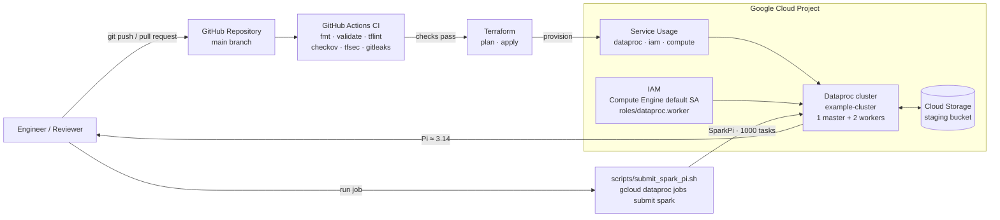

# GCP Dataproc Spark Infrastructure

> **🔴 Live case study:** **[Launch the interactive simulation →](https://ongunakaycom.github.io/gcp-dataproc-spark-infra/)**
>
> A dark-mode, static walkthrough of the full lifecycle: `terraform apply` → Dataproc cluster → SparkPi job → GKE-style `kubectl` checks → `terraform destroy`. No GCP resources are created and nothing is billed.

[](https://github.com/ongunakaycom/gcp-dataproc-spark-infra/actions/workflows/terraform-ci.yml)
[](https://ongunakaycom.github.io/gcp-dataproc-spark-infra/)
[](https://developer.hashicorp.com/terraform)
[](https://cloud.google.com/dataproc)

A production-minded reference project that provisions **Managed Service for Apache Spark** (formerly **Google Cloud Dataproc**) on Google Cloud with **Terraform**, and submits a Spark job using a small, repeatable shell script.

The project follows the official Google Cloud quickstart: create a Dataproc cluster, grant the Compute Engine default service account the Dataproc Worker role, and run the `SparkPi` example job. Everything is codified so the environment can be created and destroyed on demand.

---

## Table of contents

- [Overview](#overview)
- [Interactive case study](#interactive-case-study)
- [Architecture](#architecture)
- [Google Cloud services](#google-cloud-services)
- [IAM roles](#iam-roles)
- [Project structure](#project-structure)
- [Prerequisites](#prerequisites)
- [Deployment](#deployment)
- [CI/CD pipeline](#cicd-pipeline)
- [Enabling live plans with Workload Identity Federation](#enabling-live-plans-with-workload-identity-federation)
- [Code quality and security](#code-quality-and-security)
- [Pre-commit hooks](#pre-commit-hooks)
- [Running the Spark job](#running-the-spark-job)
- [Monitoring](#monitoring)
- [Configuration reference](#configuration-reference)
- [Cost considerations](#cost-considerations)
- [Cleanup](#cleanup)
- [Troubleshooting](#troubleshooting)
- [License](#license)

---

## Overview

This repository demonstrates how to:

- Enable the required Google Cloud APIs declaratively.
- Create a Dataproc cluster (`example-cluster`) in `us-east1` (or `europe-west1`).
- Grant the Compute Engine default service account the `roles/dataproc.worker` role — a step that is easy to miss and causes cluster creation to fail when omitted.
- Manage the Dataproc staging bucket in Terraform so no billable resources are left behind after teardown.
- Submit the classic `SparkPi` example job with a single command.
- Tear everything down with `terraform destroy`.

The workload is intentionally small: one master node and two workers of type `e2-standard-4`, with an idle-deletion policy of two hours as a safety net.

## Interactive case study

Because this portfolio project has no billing account, the repository also ships a fully static case study in [`docs/`](docs/) that is deployed to GitHub Pages:

**https://ongunakaycom.github.io/gcp-dataproc-spark-infra/**

The page includes:

- A dark-mode landing page with the project's objective, constraints and outcomes.
- An interactive CSS/SVG architecture diagram (Terraform → GCP APIs & IAM → Dataproc → SparkPi).
- A typewriter terminal simulation that replays `terraform apply`, `gcloud dataproc jobs submit spark`, GKE-style `kubectl` checks and `terraform destroy`.
- Tech-stack cards for Terraform, Google Cloud, Spark, GitHub Actions, Kubernetes and Cloud Storage.

Everything is client-side HTML, CSS and JavaScript — no backend, no credentials, no cloud spend. The terminal is a scripted animation, not a command runner.

Preview locally:

```bash
python -m http.server 8000 --directory docs
# open http://localhost:8000/
# optional: http://localhost:8000/#simulate auto-starts the simulation
```

Deployment is handled by [`.github/workflows/pages.yml`](.github/workflows/pages.yml) on every push to `main`. Enable **Settings → Pages → Source: GitHub Actions** once for the repository.

## Architecture

The diagram below shows how a change flows from the engineer through the CI
pipeline into Google Cloud, and how the Spark job reaches the Dataproc cluster.



- **GitHub Actions** validates every change before it reaches `main`.
- **Terraform** creates the APIs, IAM binding, staging bucket, and cluster. The
  CI pipeline does not run `apply`; deployment remains an explicit human action.
- **Dataproc** runs the `SparkPi` job and writes staging data and logs to Cloud
  Storage.

## Google Cloud services

| Service | API | Purpose |
| --- | --- | --- |
| Managed Service for Apache Spark (Dataproc) | `dataproc.googleapis.com` | Creates and manages the Spark cluster and jobs. |
| Identity and Access Management | `iam.googleapis.com` | Grants the Dataproc Worker role to the default compute service account. |
| Compute Engine | `compute.googleapis.com` | Provides the virtual machines that form the cluster. |
| Cloud Storage | `storage.googleapis.com` | Stores Dataproc staging files, job dependencies, and logs. |

> Cloud Storage is used by Dataproc even though its API is not explicitly enabled here; it is enabled automatically when the staging bucket is created. Enable `storage.googleapis.com` explicitly if your organization's policies require it.

## IAM roles

| Principal | Role | Why it is needed |
| --- | --- | --- |
| Compute Engine default service account (`<project-number>-compute@developer.gserviceaccount.com`) | `roles/dataproc.worker` | Allows cluster nodes to register with the Dataproc control plane and execute Spark workloads. **Required** — cluster creation fails without it. |
| The identity running Terraform | `roles/dataproc.admin`, `roles/iam.serviceAccountUser`, `roles/storage.admin`, `roles/serviceusage.serviceUsageAdmin` | Creates clusters, manages IAM bindings, and provisions the staging bucket. `roles/owner` also works for a personal demo project. |

The service account binding is created by the `google_project_iam_member.dataproc_worker` resource in [`terraform/main.tf`](terraform/main.tf). The service account itself is not created by Terraform: it is the default account that exists in every project.

## Project structure

```
.
├── .github/
│   └── workflows/
│       ├── terraform-ci.yml      # fmt, validate, tflint, security, plan
│       └── pages.yml             # Deploys docs/ to GitHub Pages
├── docs/                         # Static interactive case study (Pages)
│   ├── index.html
│   ├── styles.css
│   ├── script.js
│   ├── favicon.svg
│   └── assets/icons/
├── scripts/
│   └── submit_spark_pi.sh        # Submits the SparkPi job via gcloud
├── terraform/
│   ├── main.tf                   # Provider, APIs, IAM, bucket, cluster
│   ├── variables.tf              # Input variables and validation
│   ├── outputs.tf                # Cluster ID, bucket, submit command
│   └── terraform.tfvars.example  # Example variable values
├── .pre-commit-config.yaml       # Terraform, linting, and secret hooks
├── .tflint.hcl                   # Shared TFLint configuration
├── .gitignore
└── README.md
```

## Prerequisites

- A Google Cloud project with **billing enabled**.
- [Terraform](https://developer.hashicorp.com/terraform/install) **1.5+**.
- [Google Cloud SDK](https://cloud.google.com/sdk/docs/install) (`gcloud`) installed and authenticated.
- Permissions to create the resources listed above (see [IAM roles](#iam-roles)).
- Optional for local quality gates: [pre-commit](https://pre-commit.com/), [TFLint](https://github.com/terraform-linters/tflint), and Python 3.9+.
- On Windows, run the shell script from **Git Bash** or **WSL**.

Authenticate and select your project:

```bash
gcloud auth login
gcloud auth application-default login
gcloud config set project YOUR_PROJECT_ID
```

`gcloud auth application-default login` is required so the Terraform Google provider can obtain credentials locally.

## Deployment

1. **Configure variables.** Copy the example file and set your project ID:

   ```bash
   cd terraform
   cp terraform.tfvars.example terraform.tfvars
   ```

   ```hcl
   project_id = "your-gcp-project-id"
   region     = "us-east1"   # or "europe-west1"
   zone       = "us-east1-b" # optional; must be in the selected region
   ```

   Alternatively, export the project ID:

   ```bash
   export TF_VAR_project_id="your-gcp-project-id"
   ```

2. **Initialize Terraform.** Downloads the Google provider and prepares the working directory:

   ```bash
   terraform init
   ```

3. **Review the execution plan.** This shows exactly which APIs, IAM bindings, bucket, and cluster will be created:

   ```bash
   terraform plan -out=tfplan
   ```

4. **Apply the configuration.** Cluster creation typically takes 2–5 minutes:

   ```bash
   terraform apply tfplan
   ```

   Terraform prints useful outputs, including the cluster name and a ready-to-run job submission command.

> **Note:** `terraform apply` enables the three required APIs and waits briefly for the new IAM binding to propagate before creating the cluster. Fresh projects may still need a few minutes before the Dataproc Worker role is effective.

## CI/CD pipeline

[`.github/workflows/terraform-ci.yml`](.github/workflows/terraform-ci.yml) runs on every push to `main`, every pull request targeting `main`, and on manual dispatch. Jobs run in parallel where possible, and a new run cancels any in-progress run for the same branch.

| Job | Tool | What it checks |
| --- | --- | --- |
| **Terraform Format** | `terraform fmt -check -recursive` | HCL files are canonically formatted. |
| **Terraform Validate** | `terraform init -backend=false` + `terraform validate` | Provider schema and configuration graph are valid. |
| **TFLint** | TFLint + Terraform & Google rulesets | Deprecated syntax, invalid machine types, provider-specific best practices. |
| **Security Scan** | Checkov + tfsec | Misconfigurations such as public buckets, missing encryption, overly broad IAM. |
| **Secret Scan** | Gitleaks | Credentials, keys, and tokens accidentally committed to the repository. |
| **Terraform Plan** | `terraform validate` (syntax-only) | Configuration is re-validated; a live plan is gated behind WIF credentials. |

### Why the plan stage is syntax-only

This is a public portfolio repository without a dedicated GCP project, so the
workflow must not depend on live cloud credentials. The plan job:

1. Initializes the configuration with `-backend=false`.
2. Runs `terraform validate` again to exercise the full configuration graph.
3. Writes a summary to the GitHub Actions job summary.

The Workload Identity Federation authentication block and the real
`terraform plan` command are included in the workflow as commented-out code.
This keeps the production shape visible without requiring secrets to be present
for contributors and forks.

The separate [`.github/workflows/pages.yml`](.github/workflows/pages.yml)
workflow publishes the static case study in `docs/` to GitHub Pages on every
push to `main`.

## Enabling live plans with Workload Identity Federation

The recommended production setup avoids long-lived service account keys by
using GitHub's OIDC token with [Workload Identity Federation](https://cloud.google.com/iam/docs/workload-identity-federation).

Create the pool, provider, and service account (one-time bootstrap):

```bash
PROJECT_ID="your-gcp-project-id"
PROJECT_NUMBER="$(gcloud projects describe "$PROJECT_ID" --format='value(projectNumber)')"
REPO="ongunakaycom/gcp-dataproc-spark-infra"

gcloud iam workload-identity-pools create github-pool \
  --project="$PROJECT_ID" \
  --location=global \
  --display-name="GitHub Actions"

gcloud iam workload-identity-pools providers create-oidc github-provider \
  --project="$PROJECT_ID" \
  --location=global \
  --workload-identity-pool=github-pool \
  --display-name="GitHub OIDC" \
  --issuer-uri="https://token.actions.githubusercontent.com" \
  --attribute-mapping="google.subject=assertion.sub,attribute.repository=assertion.repository" \
  --attribute-condition="assertion.repository=='${REPO}'"

gcloud iam service-accounts create github-terraform \
  --project="$PROJECT_ID" \
  --display-name="Terraform CI"

for role in \
  roles/dataproc.admin \
  roles/compute.admin \
  roles/iam.serviceAccountUser \
  roles/storage.admin \
  roles/serviceusage.serviceUsageAdmin; do
  gcloud projects add-iam-policy-binding "$PROJECT_ID" \
    --member="serviceAccount:github-terraform@${PROJECT_ID}.iam.gserviceaccount.com" \
    --role="$role" \
    --condition=None
done

gcloud iam service-accounts add-iam-policy-binding \
  "github-terraform@${PROJECT_ID}.iam.gserviceaccount.com" \
  --project="$PROJECT_ID" \
  --role="roles/iam.workloadIdentityUser" \
  --member="principalSet://iam.googleapis.com/projects/${PROJECT_NUMBER}/locations/global/workloadIdentityPools/github-pool/attribute.repository/${REPO}"
```

Add these repository secrets (**Settings → Secrets and variables → Actions**):

| Secret | Value |
| --- | --- |
| `GCP_WORKLOAD_IDENTITY_PROVIDER` | `projects/<PROJECT_NUMBER>/locations/global/workloadIdentityPools/github-pool/providers/github-provider` |
| `GCP_SERVICE_ACCOUNT` | `github-terraform@<PROJECT_ID>.iam.gserviceaccount.com` |
| `GCP_PROJECT_ID` | Your Google Cloud project ID. |

Then, in `.github/workflows/terraform-ci.yml`:

1. Uncomment the **Workload Identity Federation authentication** block in the `plan` job.
2. Uncomment the **Live plan** step at the end of the job (and remove the syntax-only step if desired).

The workflow deliberately does **not** run `terraform apply`. Infrastructure
changes are applied manually after review, which keeps production credentials
out of automatic deployment paths.

## Code quality and security

| Layer | Tool | Where |
| --- | --- | --- |
| Formatting | `terraform fmt` | CI + pre-commit |
| Validation | `terraform validate` | CI + pre-commit |
| Linting | TFLint (Terraform + Google rulesets) | CI + pre-commit |
| IaC security | Checkov + tfsec | CI |
| Secret detection | Gitleaks | CI + pre-commit |

Checkov and tfsec run with `soft_fail: true` so findings are reported without
blocking contributors; remove that flag to enforce a zero-findings policy. The
same scans can be run locally:

```bash
# TFLint
tflint --init --config=.tflint.hcl
tflint --recursive --config=.tflint.hcl

# Checkov
pip install checkov
checkov -d terraform --framework terraform

# tfsec
docker run --rm -v "$PWD:/src" aquasec/tfsec /src/terraform
```

## Pre-commit hooks

[`.pre-commit-config.yaml`](.pre-commit-config.yaml) runs fast local checks
before every commit:

| Hook | Purpose |
| --- | --- |
| `trailing-whitespace`, `end-of-file-fixer` | File hygiene. |
| `check-yaml`, `check-merge-conflict`, `check-added-large-files` | Repository safety checks. |
| `detect-private-key` | Blocks accidental private key commits. |
| `terraform_fmt`, `terraform_validate`, `terraform_tflint` | Terraform quality gates. |
| `gitleaks` | Secret scanning. |

Install and run:

```bash
pip install pre-commit          # or: pipx install pre-commit
pre-commit install              # installs the Git pre-commit hook
pre-commit run --all-files      # run every hook against the repository
```

`terraform` and `tflint` must be available on `PATH`; pre-commit manages the
Gitleaks binary in its own environment.

## Running the Spark job

After the apply completes, submit the `SparkPi` example:

```bash
./scripts/submit_spark_pi.sh
```

The script runs the equivalent of:

```bash
gcloud dataproc jobs submit spark \
  --cluster=example-cluster \
  --region=us-east1 \
  --class=org.apache.spark.examples.SparkPi \
  --jars=file:///usr/lib/spark/examples/jars/spark-examples.jar \
  -- 1000
```

The final argument (`1000`) is the number of tasks used by the Monte Carlo estimation. When the job finishes, the driver output contains a line similar to:

```
Pi is roughly 3.141591
```

To target a different cluster or region without editing the script:

```bash
CLUSTER_NAME=my-cluster REGION=europe-west1 ./scripts/submit_spark_pi.sh
```

## Monitoring

```bash
# List recent jobs
gcloud dataproc jobs list --region=us-east1

# Describe the cluster
gcloud dataproc clusters describe example-cluster --region=us-east1

# Stream the driver output of a job
gcloud dataproc jobs wait JOB_ID --region=us-east1
```

Cluster and job details, including the Spark UI link and Cloud Logging output, are also available in the [Google Cloud console](https://console.cloud.google.com/dataproc).

## Configuration reference

| Variable | Type | Default | Description |
| --- | --- | --- | --- |
| `project_id` | `string` | — (required) | Google Cloud project ID. |
| `region` | `string` | `us-east1` | Cluster region; `us-east1` or `europe-west1`. |
| `zone` | `string` | `null` | Zone for cluster nodes. When omitted, Dataproc selects a zone in `region`. |
| `cluster_name` | `string` | `example-cluster` | Dataproc cluster name. |
| `image_version` | `string` | `2.2-debian12` | Dataproc image version. |
| `master_machine_type` | `string` | `e2-standard-4` | Master node machine type. |
| `worker_machine_type` | `string` | `e2-standard-4` | Worker node machine type. |
| `worker_count` | `number` | `2` | Number of workers (0–10). |
| `idle_delete_ttl` | `string` | `7200s` | Delete the cluster after this idle period. |
| `labels` | `map(string)` | demo labels | Labels applied to the cluster. |

Outputs:

| Output | Description |
| --- | --- |
| `cluster_name` / `cluster_id` | Cluster identifiers. |
| `staging_bucket` | GCS bucket used for staging and logs. |
| `default_compute_service_account` | Service account granted `roles/dataproc.worker`. |
| `submit_job_command` | Complete `gcloud dataproc jobs submit spark` command. |

## Cost considerations

A running Dataproc cluster bills for:

- **Compute Engine instances** — one master and two workers by default. Approximate cost is around **$0.40 per hour** for three `e2-standard-4` instances in `us-east1`; check the [Compute Engine pricing page](https://cloud.google.com/compute/pricing) for current rates.
- **Persistent disk** — 100 GB standard PD per node (300 GB total), billed monthly even while the cluster is idle.
- **Cloud Storage** — a few cents per month for staging data and logs.
- **Dataproc service fee** — none for clusters using the standard image; you pay only for the underlying resources.

Cost-saving measures built into this project:

- The cluster is deleted automatically after **two hours of inactivity** (`idle_delete_ttl`).
- The staging bucket has a **7-day object lifecycle rule**.
- `terraform destroy` removes the cluster and the staging bucket, so nothing keeps billing after teardown.

**Always run `terraform destroy` when you are done.**

## Cleanup

```bash
cd terraform
terraform destroy
```

Terraform removes the Dataproc cluster, the staging bucket (including its objects, via `force_destroy`), and the IAM binding. The three APIs remain enabled because `disable_on_destroy = false`; this avoids breaking other workloads in the same project. Remove them manually if desired:

```bash
gcloud services disable dataproc.googleapis.com compute.googleapis.com iam.googleapis.com
```

## Troubleshooting

| Symptom | Likely cause | Fix |
| --- | --- | --- |
| `PERMISSION_DENIED: ... does not have storage.objects...` or cluster creation fails immediately after apply | The `roles/dataproc.worker` binding has not propagated yet | Wait 1–2 minutes and re-run `terraform apply`, or recreate the cluster. |
| `Google Compute Engine: Required 'compute.instances.create' permission` | The Terraform identity lacks Compute Engine permissions | Grant `roles/compute.admin` or use a project with Owner/Editor. |
| `Invalid value for field 'resource.zone'` | `zone` is not in the selected `region` | Set a matching zone (e.g. `europe-west1-b`) or leave `zone` unset. |
| `Bucket name is already in use` | The staging bucket name is globally taken | Change `project_id` or the bucket naming pattern in `main.tf`. |
| `The requested image version is not available` | The image version is unavailable in the region | Pin a supported version, e.g. `2.1-debian11`, in `terraform.tfvars`. |
| `gcloud: command not found` | Cloud SDK is not installed or not on `PATH` | Install the Google Cloud SDK and reopen the terminal. |
| `./scripts/submit_spark_pi.sh: Permission denied` | Script is not executable | Run `chmod +x scripts/submit_spark_pi.sh`. |
| Job hangs or cluster reports no workers | Worker quota exhausted in the region | Check quotas in **IAM & Admin → Quotas** and reduce `worker_count`. |

---

## License

This project is provided for educational and portfolio purposes. Use it at your own risk and review the configuration before applying it to a production project.
